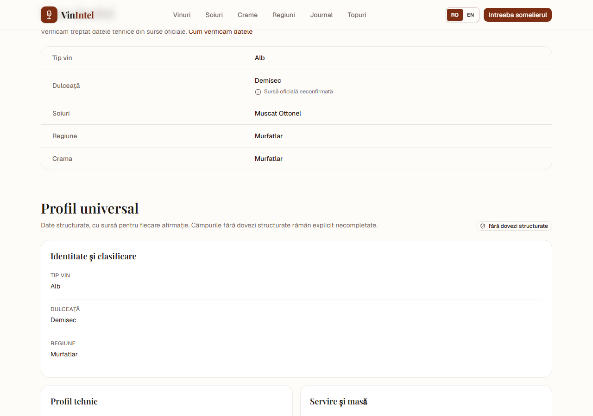

# Universal Wine Profile UI

The wine detail page now includes a source-backed **Profil universal** / **Universal
profile** section, rendered from structured V2 claims (`wine_claim_evidence`) and
genuinely structured catalog fields.

## Sections

- Identity and classification: wine type, sweetness, vintage, region, appellation
- Technical profile: alcohol, residual sugar, acidity, bottle volume
- Structured sensory profile: appearance, aroma, taste, body, acidity perception,
  tannin, finish
- Serving and table: serving temperature, structured food pairings
- Grapes and context: grape names/percentages with links to the matching
  `/soiuri` grape guide

## Evidence display

Each structured field displays:

- the value;
- a verification badge (`verified_official`, `corroborated`,
  `attributed_retailer`, `attributed_specialist`, `attributed_editorial`,
  `conflict`, or `unverified`);
- a clickable source title/URL when available;
- a conflict badge when two structured values disagree.

Free-text `Culoare/Miros/Gust/Temperatura` does **not** populate the structured
profile. If migration 0028 has not been applied or a wine has no claims, the UI
shows an explicit empty-state message instead of presenting generic prose as a
fact. The catalog's existing identity/technical specs remain visible.

## Screenshot



The screenshot is from the local production build. Because migration 0028 is not
applied to production and the target has no `wine_claim_evidence` rows yet, the
screenshot demonstrates the honest empty structured state and the surrounding
identity/grape context.

## Tests

`lib/wine-universal-profile.test.ts` covers:

- structured sensory/serving/grape rendering with source attribution;
- empty sensory/serving state when only free text exists;
- conflict marking between official and retailer claims.

Browser smoke check also verifies the heading and mobile/desktop layout:

```bash
BROWSER_BASE_URL=http://127.0.0.1:3114 \
BROWSER_WINE_SLUG=murfatlar-zestrea-muscat-ottonel-demisec-0-75l \
node scripts/browser-check.mjs
```
